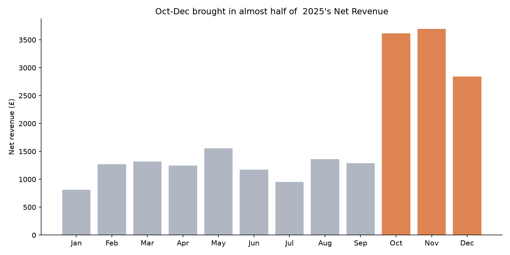
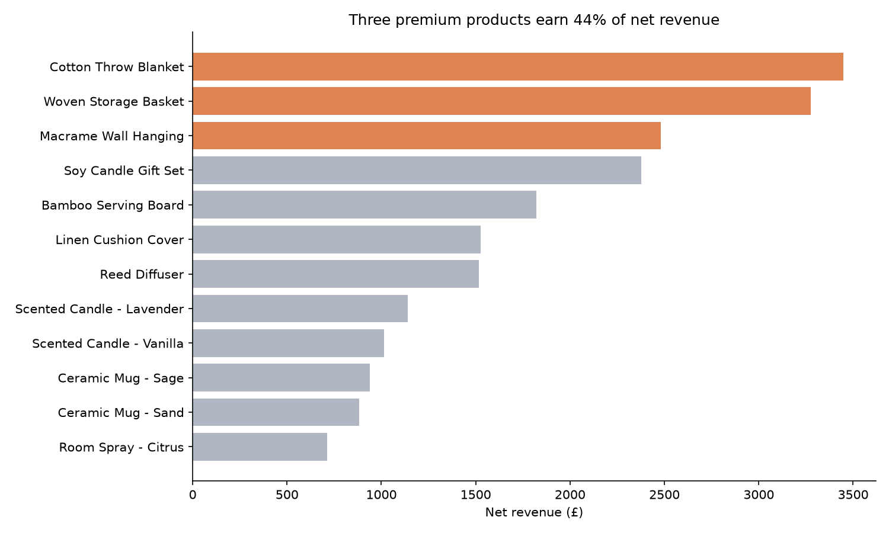
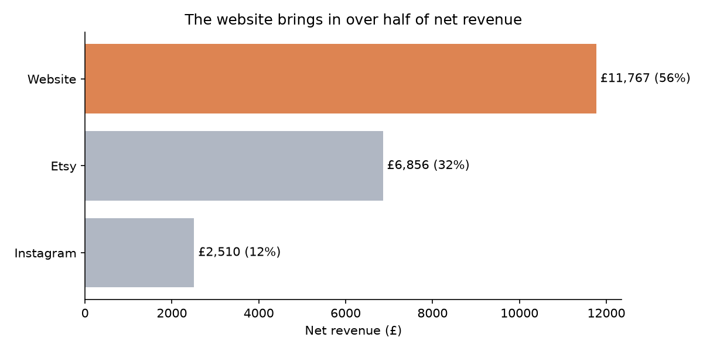

# Sales Data Cleaning & Analysis: Small E-commerce Shop (Case Study)

> **Note:** This is a practice case study based on a realistic client scenario. The shop ("Willow & Wick"), the client and the data are fictional.

## The brief

A small UK home-goods shop sells through its **website, Etsy and Instagram**. Its 2025 sales export combined all three platforms into one messy file, and the owner's numbers "felt off". She asked for:

1. A clean, trustworthy dataset
2. Answers: strongest months, top products and categories, key regions and channels, and the cost of returns
3. 3–4 simple charts and a one-page plain-English summary

## What I did

**1. Explored the raw data** (638 rows) and found 7 data-quality problems:

| Problem | Fix |
|---|---|
| 18 duplicate orders from the platform export | Removed (620 real orders remain) |
| Dates in 3 different formats (UK day-first) | Parsed each format explicitly into one date type |
| Prices stored as text with a `£` sign | Converted to numbers |
| Product names in mixed case with trailing spaces | Standardised (24 variants → 12 products) |
| Region spelling variants (`SE`, `South-East`, `london`) | Mapped to 6 clean regions; blanks labelled "Unknown" |
| Missing categories and customer IDs | Categories recovered from product names; blank customers labelled "Guest" (confirmed with client) |
| Negative quantities | Identified as **returns**: kept and flagged, not deleted |

**2. Asked the client a clarifying question** before analysing: were prices before or after discount codes? (Before.) Applying the 10% / 15% discounts **corrected an overstatement of about £890** in revenue.

**3. Analysed net revenue** (after discounts and returns) by month, product, category, region and channel.

## Key findings

**Almost half the year's revenue arrives in October–December (~48%).**



**Three premium products earn 44% of revenue.** Most products sell in similar volumes, so price drives the difference. The Woven Storage Basket is both the best-selling and a top-earning product.



**The website brings in 56% of revenue.** Instagram orders are about 22% smaller on average (£27 vs £35).



Other findings: London + South East = 52% of revenue; returns cost about 4% of sales.

## Recommendations to the client

1. Build stock of the top three products by September and focus marketing on October–November.
2. Feature premium products and bundles on Instagram to lift the average order.
3. Expand the Storage and Decor ranges, where single products already outperform whole categories.

📄 Full client summary: [`outputs/summary_for_sarah.md`](outputs/summary_for_sarah.md)

## Project structure

```
├── data/
│   ├── raw/          # original client file (untouched)
│   └── processed/    # cleaned dataset
├── notebooks/
│   ├── 01_data_cleaning.ipynb
│   └── 02_analysis.ipynb
├── outputs/
│   ├── charts/       # 3 charts (PNG)
│   └── summary_for_sarah.md
└── requirements.txt
```

## Tools

Python · pandas · matplotlib · Jupyter · Git/GitHub

## How to run

```bash
python3 -m venv .venv
source .venv/bin/activate
pip install -r requirements.txt
jupyter notebook
```

Run `01_data_cleaning.ipynb`, then `02_analysis.ipynb`.
